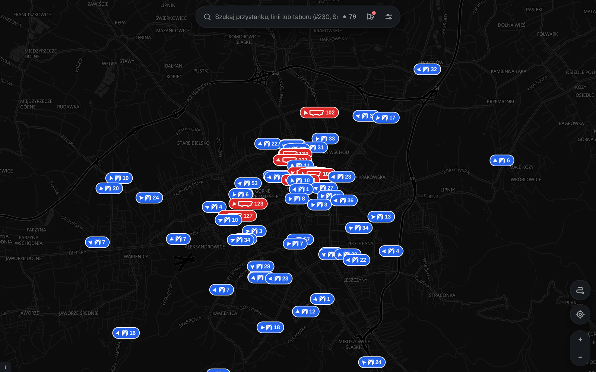

<div align="center">


# Unimaps

Live public transport map for Bielsko-Biała, Metropolia GZM and 53 other Polish cities.

**[map.unisic.app](https://map.unisic.app)**

</div>



Every running vehicle with its delay, stop departure boards, trip timelines on road geometry and a journey
planner. One Rust process (`backend/`, binary `unimaps`) serves the map (a static Svelte 5 build), the JSON API
and a GTFS-Realtime feed, and runs the pollers. No database.

## Run

Needs Node.js 24+ (frontend build) and Rust 1.95+.

```bash
npm install
npm run dev                      # map on :8080 (Vite), API on 127.0.0.1:8081
```

Production:

```bash
npm run build && npm start       # map + API on :8080
docker compose up -d --build     # the same in a container: static binary + out/
```

Checks: `npm run typecheck && npm run lint && npm test`, and in `backend/`:
`cargo fmt --check && cargo clippy --all-targets -- -D warnings && cargo test`.

Settings are optional `KB_*` environment variables, all listed in `.env.example`. Generated state (GTFS
feeds, road shapes, fleet history) lives in `output/`.

## API

| Endpoint | |
|---|---|
| `/api/vehicles` | live vehicles with delays |
| `/api/gtfs-rt.pb` | GTFS-Realtime VehiclePositions (Bielsko-Biała) |
| `/api/stops` | stop list |
| `/api/stop/:id/departures`, `/api/stop/:id/timetable` | departures, day timetable |
| `/api/connections?from=&to=` | journey planner |
| `/api/health` | status and scan counters |

List endpoints take `?city=<slug>` (`gzm`, `warsaw`, …, see `lib/shared/cities.json`); without it they answer
for Bielsko-Biała. Every route is in `backend/src/api/mod.rs`.

## Data

Independent project, not affiliated with any operator.

- Komunikacja Beskidzka: [komunikacjabeskidzka.kiedyprzyjedzie.pl](https://komunikacjabeskidzka.kiedyprzyjedzie.pl)
- MZK Bielsko-Biała: [rozklady.bielsko.pl](https://rozklady.bielsko.pl)
- Metropolia GZM: ZTM / Metropolia GZM (CC BY), plus SDIP
- Other cities: each operator's GTFS and vehicle positions, via zbiorkom
- Map: © [OpenStreetMap](https://www.openstreetmap.org/copyright) contributors, tiles by [OpenFreeMap](https://openfreemap.org); routing: [OSRM](https://project-osrm.org)
- Vehicle photos: [phototrans.eu](https://phototrans.eu), each credited to its author

What the app keeps about you: `/prywatnosc` (Polish).

## License

GPLv3 or later. See [LICENSE](LICENSE).
