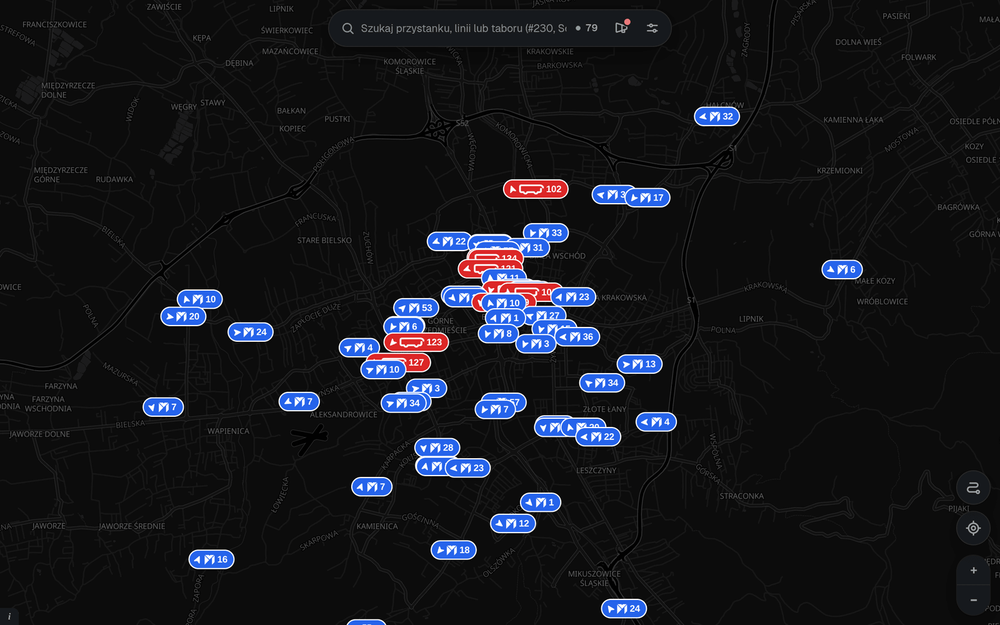

<div align="center">


# Unimaps

A live public transport map for Bielsko-Biała and Metropolia GZM.

</div>



Operator portals show departures one stop at a time. Unimaps shows the whole
fleet at once: every running vehicle with its delay, stop departure boards,
trip timelines on road geometry and a journey planner. It also publishes a
GTFS feed and a GTFS-Realtime feed.

Unimaps runs as one Node.js process: Next.js 16 serves the map, the JSON API and
the feeds, and the pollers run in the same process. No separate scraper daemon
and no database.

## Features

- Live positions every 4 to 5 s, with delays. KB delays are corrected from GPS
  when upstream's stop index stalls behind the bus.
- Departure boards and full timetables per stop. Nearby departures, departure
  alerts, and favourite stops kept for offline use.
- Trip timelines on road-following shapes, routed and stored on the server
- Journey planner (range RAPTOR) with walking transfers between stops up to
  350 m apart
- Fleet and brigade view at `/brygady`
- Optional smooth motion that dead-reckons buses along their route between
  fixes, an installable PWA, and a `Ctrl+K` search for stops, lines and
  vehicles

## Cities

| City | Operators | Sources |
|---|---|---|
| Bielsko-Biała | Komunikacja Beskidzka (KB), MZK Bielsko-Biała | KiedyPrzyjedzie (KB), OnTime (MZK), stops of both merged into one list |
| Metropolia GZM | ZTM: buses, trams, trolleybuses | zbiorkom.live GTFS and positions, SDIP overlay every 5 s |

On first visit the map asks for a city and remembers it. `?city=gzm` opens GZM.
The two cities are isolated: a GZM failure never touches Bielsko-Biała data.

## Run

Requires Node.js 24 or newer.

```bash
git clone https://github.com/unisic/unimaps.git
cd unimaps
npm install
npm run dev          # map + pollers on http://localhost:8080
```

Production:

```bash
npm run build
npm start            # standalone server on port 8080
```

Docker:

```bash
docker compose up -d --build
```

The healthcheck marks the container `unhealthy` when the scan loop stalls or
upstream goes stale (`/api/health` answers 503). `restart: unless-stopped`
acts only on process exit, so point an uptime monitor at `/api/health`.

Checks: `npm run typecheck`, `npm run lint`, `npm test`.

## API

| Endpoint | |
|---|---|
| `/api/vehicles` | Live vehicles with delay, heading, route shape and along-route distance |
| `/api/gtfs-rt.pb` | GTFS-Realtime `VehiclePositions` (Bielsko-Biała) |
| `/api/stops` | Merged stop list with direction arrows, `ETag` + 304 |
| `/api/stop/:id/departures` | Live and scheduled departures |
| `/api/stop/:id/timetable` | Full day timetable |
| `/api/trip/:id`, `/api/trip_execution`, `/api/trips` | Trip timelines |
| `/api/connections?from=&to=` | Journey planner |
| `/api/lines` | Line catalogue |
| `/api/shapes?ids=` | Stored road geometry, immutable-cached |
| `/api/fleet`, `/api/fleet/:side`, `/api/fleet/timeline` | Fleet and brigades |
| `/api/announcements` | KB service announcements |
| `/api/health` | Status, scan counters, feed age, shape store |

List endpoints take `?city=gzm`; without it they answer for Bielsko-Biała.
GZM ids carry a `gzm:` prefix (`gzm:<stop_id>`, `gzm:<trip_id>`,
`gzm:<operator>_<fleet>`). While the GZM feed loads, its endpoints answer 503
with `Retry-After: 10`.

## Configuration

All settings are optional `KB_*` environment variables, read once at start.
`.env.example` documents every one. The ones you are most likely to touch:

| Variable | Default | |
|---|---|---|
| `KB_OSRM_URL` | `https://router.project-osrm.org/route/v1/driving` | `off` disables server-side road routing |
| `KB_OSRM_MIN_INTERVAL_MS` | `1100` | at least 1000 on the public OSRM host |
| `KB_USER_AGENT` | `unimaps/2.0 (+https://github.com/unisic/unimaps)` | sent to every upstream |
| `KB_GPS_DELAY` | `1` | `0` keeps upstream's raw KB delay |
| `KB_GZM` | `1` | `0` switches Metropolia GZM off |
| `KB_GZM_SDIP` | `1` | `0` disables the SDIP position overlay |

Generated state lives in `output/` (Docker volume `kb-output`): the static
GTFS feed, road shapes, learned stop directions and fleet history. Delete a
file to rebuild it.

## Static GTFS

The server rebuilds the Bielsko-Biała GTFS feed every night. To build it by
hand:

```bash
npm run build:gtfs -- --date 2026-11-02 --out output/gtfs
```

Flags: `--date YYYY-MM-DD` (default today), `--out DIR`, `--concurrency N`,
`--no-zip`, `--single-day`. Output is written atomically, including
`kb_gtfs.zip`.

## Data

Unimaps is an independent project, not affiliated with any operator. Data
comes from:

- Komunikacja Beskidzka: [komunikacjabeskidzka.kiedyprzyjedzie.pl](https://komunikacjabeskidzka.kiedyprzyjedzie.pl)
- MZK Bielsko-Biała: [rozklady.bielsko.pl](https://rozklady.bielsko.pl)
- Metropolia GZM: ZTM / Metropolia GZM (CC BY), via [zbiorkom.live](https://zbiorkom.live), plus SDIP
- Map: © [OpenStreetMap](https://www.openstreetmap.org/copyright) contributors, tiles by [OpenFreeMap](https://openfreemap.org)
- Road routing: [OSRM](https://project-osrm.org)

## License

GPLv3 or later. See [LICENSE](LICENSE).
