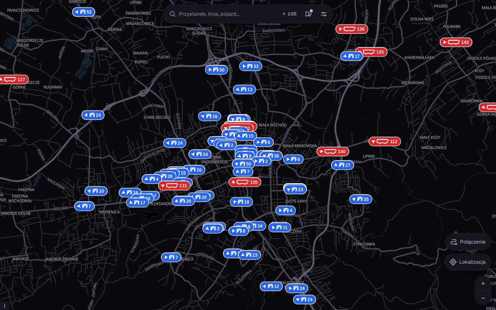
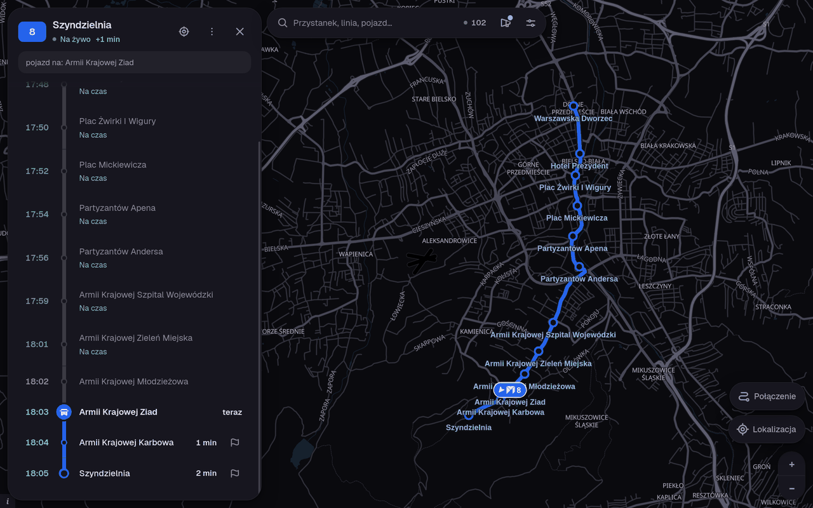
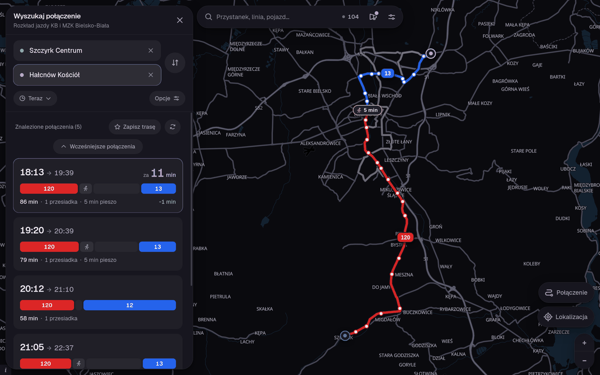
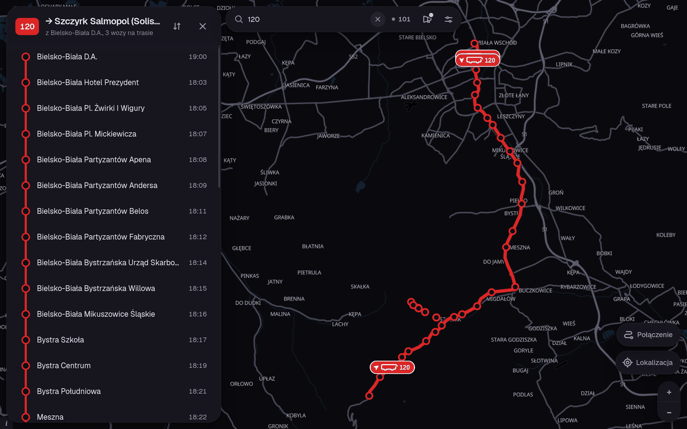
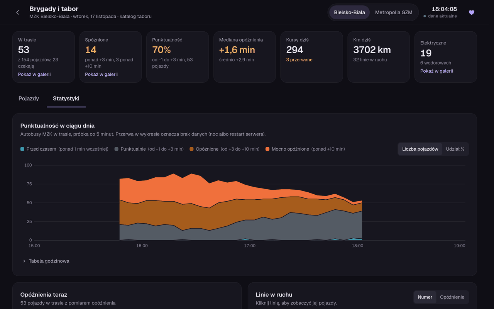

<div align="center">


# Unimaps

Live public transport map for Bielsko-Biała, Metropolia GZM and 53 other Polish cities.

**[map.unisic.app](https://map.unisic.app)**

</div>



One server (closed source) serves the map (this repo: a static Svelte 5 build), the JSON API and a GTFS-Realtime
feed, and runs the pollers.

## What it does

- **Live map.** Every running vehicle with its delay, moving along the road between two position fixes.
- **Stops and trips.** Departure boards, day timetables, and a trip's timeline with its route on road geometry.
- **Connection search.** From a stop, an address or a point on the map, with transfers, live delays, walking
  times along footpaths and the alternative routes drawn on the map.
- **Line view.** A line's two directions as a stop diagram with its vehicles on it.
- **Fleet (`/brygady`).** Vehicles of MZK Bielsko-Biała and Metropolia GZM by model, punctuality through the
  day, each vehicle's past courses.

| | |
|---|---|
|  |  |
|  |  |

## Run

Needs Node.js 24+.

```bash
npm install
npm run dev                      # map on :8080 (Vite), /api proxied to map.unisic.app (KB_API_URL)
npm run build                    # static build in out/
```

Checks: `npm run typecheck && npm run lint && npm test`.

## API

| Endpoint | |
|---|---|
| `/api/vehicles` | live vehicles with delays |
| `/api/gtfs-rt.pb` | GTFS-Realtime VehiclePositions (Bielsko-Biała) |
| `/api/stops` | stop list |
| `/api/stop/:id/departures`, `/api/stop/:id/timetable` | departures, day timetable |
| `/api/line?name=` | a line's stop patterns and departures |
| `/api/connections?from=&to=` | connection search |
| `/api/fleet`, `/api/fleet/:side` | fleet list, one vehicle's card |
| `/api/health` | status and scan counters |

List endpoints take `?city=<slug>` (`gzm`, `warsaw`, …, see `lib/shared/cities.json`); without it they answer
for Bielsko-Biała.

## Data

Independent project, not affiliated with any operator.

- Komunikacja Beskidzka: [komunikacjabeskidzka.kiedyprzyjedzie.pl](https://komunikacjabeskidzka.kiedyprzyjedzie.pl)
- MZK Bielsko-Biała: [rozklady.bielsko.pl](https://rozklady.bielsko.pl)
- Metropolia GZM: ZTM / Metropolia GZM (CC BY), plus SDIP
- Other cities: each operator's GTFS and vehicle positions, via zbiorkom
- Map: © [OpenStreetMap](https://www.openstreetmap.org/copyright) contributors, tiles by [OpenFreeMap](https://openfreemap.org); routing: [OSRM](https://project-osrm.org); address search: [Photon](https://photon.komoot.io)
- Vehicle photos: [phototrans.eu](https://phototrans.eu), each credited to its author

What the app keeps about you: `/prywatnosc` (Polish).

## License

GPLv3 or later. See [LICENSE](LICENSE).
